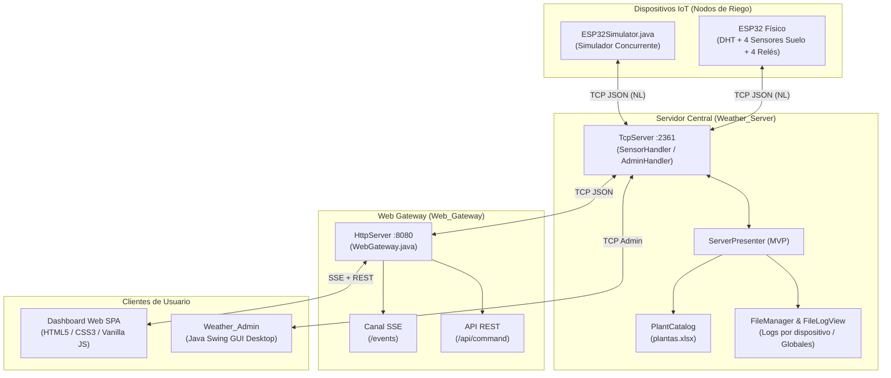

# 🌱 Sistema de Monitoreo y Riego Automatizado IoT (V2)

Sistema distribuido IoT para monitoreo ambiental y riego automatizado inteligente de plantas en macetas, soportando múltiples slots independientes por dispositivo, control manual y autónomo, catálogo botánico y visualización web en tiempo real.

---

## 🏛️ Arquitectura General



---

## 📦 Módulos del Proyecto

### 1. 🖥️ `Weather_Server` (Núcleo Backend)
* **Tecnología**: Java 17+ (Sin frameworks pesados, arquitectura orientada a sockets de bajo nivel).
* **Puerto TCP**: `2361`.
* **Características**:
  * **Concurrencia multihilo**: `SensorHandler` para nodos ESP32 y `AdminHandler` para clientes de gestión/gateway.
  * **Catálogo Botánico Dinámico**: Lector XML/XLSX (`plantas.xlsx`) que interpreta umbrales óptimos, mínimos y máximos de humedad para cientos de especies sin dependencias externas pesadas.
  * **Persistencia y Registro por Dispositivo**: Cada ESP32 o simulador conectado genera y mantiene su propio archivo de registro histórico en `files/{dispositivo}.txt` con detalle tabular por timestamp, ambiente (temperatura, humedad, índice de calor) y telemetría de los 4 slots de sustrato.
  * **Sistema de Logs**: Salida dual en consola y archivo general (`logs/server.log`).

### 2. 🌐 `Web_Gateway` (Gateway HTTP & Interfaz Web)
* **Tecnología**: Java `com.sun.net.httpserver` (Puerto `8080`) + Frontend Web moderno (SPA).
* **Características**:
  * **Proxy Reactivo**: Puente bidireccional entre el protocolo TCP del servidor y los clientes web mediante **Server-Sent Events (SSE)** y endpoints REST (`POST /api/command`).
  * **Dashboard Web Moderno**:
    * KPIs en vivo (dispositivos activos, plantas monitoreadas, alertas de estrés hídrico, temperatura promedio).
    * Tarjetas de dispositivos con micro-gráficos sparkline SVG reactivos.
    * Indicadores de humedad con corchetes visuales de rango óptimo.
    * Acciones directas: disparo de riego manual, asignación de especie vegetal desde catálogo y renombrado de dispositivo.
    * Gestión de dispositivos: ocultar/eliminar tarjetas desconectadas o no deseadas con notificación toast y opción de restauración instantánea ("Deshacer").
    * Selector de tema claro/oscuro persistente y diseño responsivo optimizado para móviles y escritorio.

### 3. 🤖 `ESP32_PlantMonitor` (Firmware de Nodos de Riego)
* **Plataforma**: ESP32 (Xtensa Dual-Core 240 MHz).
* **Versiones Disponibles**:
  * **Arduino (`.ino`)**: Implementación probada con reconexión WiFi/TCP, backoff exponencial, persistencia NVS (`Preferences`), control de 4 bombas por relé y riego autónomo local.
  * **ESP-IDF (C nativo)**: Estructura modular preparada para FreeRTOS, tareas independientes distribuidas por core (sensores en Core 0, red en Core 1), calibración precisa de ADC y eliminación de fragmentación de memoria heap.
* **Periféricos soportados**:
  * Sensor ambiental DHT11 / DHT22 en `GPIO 4`.
  * 4 Sensores de humedad de suelo capacitivos o resistivos (ADC1: `GPIO 34, 35, 32, 33`).
  * 4 Relés para electroválvulas o minibombas (`GPIO 25, 26, 27, 14`).
  * LED de estado onboard (`GPIO 2`).
* **Seguridad y Autonomía**:
  * Riego autónomo local: si la humedad de un slot cae por debajo del umbral mínimo, el firmware dispara el riego aunque no exista conexión WiFi ni servidor disponible.
  * Ventana de gracia tras arranque (10s) y cooldown de re-riego (6h) para evitar saturación de sustrato o fallos por transitorios.

### 4. 🧪 `ESP32Simulator.java` & `Weather_Simulator`
* **Propósito**: Emulación de múltiples nodos ESP32 con simulación estocástica de secado y absorción de agua para pruebas de esfuerzo y desarrollo sin necesidad de hardware físico.

### 5. 🛠️ `Weather_Admin` (Consola de Administración Desktop)
* Interfaz gráfica en Java Swing para monitoreo operativo, inspección de paquetes y comandos directos al servidor TCP.

---

## 📡 Protocolo de Comunicación

La comunicación entre el servidor central y los nodos de riego utiliza tramas JSON delimitadas por salto de línea (`\n`).

### 1. Telemetría (ESP32 / Simulador ➔ Servidor)
```json
{
  "id": 142,
  "dispositivo": "ESP32-JARDIN-SUR",
  "timestamp": 1284500,
  "sensores": {
    "temperatura": 24.5,
    "humedad": 58.0,
    "indice_calor": 25.1
  },
  "red": {
    "rssi": -65,
    "ip": "192.168.1.45"
  },
  "plantas": [
    { "slot": 0, "plantKey": "Potos", "humedad": 42.0, "regadoEn": 1200000 },
    { "slot": 1, "plantKey": "Helecho", "humedad": 68.5, "regadoEn": 0 },
    { "slot": 2, "plantKey": "", "humedad": 0.0, "regadoEn": 0 },
    { "slot": 3, "plantKey": "", "humedad": 0.0, "regadoEn": 0 }
  ]
}
```

### 2. Comandos (Servidor ➔ ESP32 / Simulador)

* **Riego Manual**:
  ```json
  { "cmd": "water", "slot": 0 }
  ```
* **Asignar / Desasignar Planta**:
  ```json
  { "cmd": "assignPlant", "slot": 0, "plantKey": "Monstera", "humMin": 40.0, "humMax": 70.0, "humOpt": 55.0 }
  ```
* **Renombrar Dispositivo**:
  ```json
  { "cmd": "rename", "name": "ESP32-INVERNADERO" }
  ```

---

## 🚀 Guía de Instalación y Ejecución

### Prerrequisitos
* **Java Development Kit (JDK)**: Versión 17 o superior.
* **Arduino IDE 2.x** o **ESP-IDF v5.x** (si se programa el microcontrolador físico).

---

### Paso 1: Iniciar el Servidor Central (`Weather_Server`)

El servidor central debe ejecutarse en primer lugar para escuchar conexiones de sensores y pasarelas:

```powershell
cd Weather_Server
# Compilar fuentes
javac -d bin -cp "src" (Get-ChildItem -Path "src" -Recurse -Filter "*.java").FullName
# Ejecutar servidor TCP
java -cp "bin" presenter.WeatherServer
```
> El servidor escuchará en el puerto **`2361`**.

---

### Paso 2: Iniciar el Gateway Web (`Web_Gateway`)

En una segunda terminal, lanza la pasarela HTTP y el panel web:

```powershell
cd Web_Gateway
# Compilar fuentes
javac -d bin -cp "src" (Get-ChildItem -Path "src" -Recurse -Filter "*.java").FullName
# Ejecutar gateway HTTP
java -cp "bin" WebGateway
```

Abre tu navegador en:
👉 **`http://localhost:8080`**

---

### Paso 3: Conectar Dispositivos

#### Opción A: Probar con el Simulador (Sin Hardware)
En una tercera terminal, ejecuta el simulador Java para generar dispositivos virtuales:

```powershell
# Desde la raíz del proyecto
javac ESP32Simulator.java
java ESP32Simulator
```
*Verás aparecer de inmediato el dispositivo en la interfaz web de `http://localhost:8080` con telemetría en tiempo real.*

#### Opción B: Flashear un ESP32 Físico
1. Abre `ESP32_PlantMonitor/ESP32_PlantMonitor.ino` en Arduino IDE.
2. Instala las librerías requeridas: `DHT sensor library`, `Adafruit Unified Sensor`, `ArduinoJson` (v6.x).
3. Configura las constantes en la cabecera:
   ```cpp
   #define WIFI_SSID   "TU_RED_WIFI"
   #define WIFI_PASS   "TU_PASSWORD"
   #define SERVER_HOST "IP_DE_TU_PC" // IP local donde corre WeatherServer
   #define SERVER_PORT 2361
   ```
4. Conecta el ESP32 por USB y presiona **Subir**.

---

### Paso 4 (Opcional): Interfaz de Administración Desktop
Si deseas utilizar la consola Swing de escritorio:

```powershell
cd Weather_Admin
javac -d bin -cp "src" (Get-ChildItem -Path "src" -Recurse -Filter "*.java").FullName
java -cp "bin" presenter.Run
```

---

## 📁 Estructura del Repositorio

```text
Irrigation_Sistem_V2/
├── ESP32_PlantMonitor/       # Código fuente del firmware para ESP32
│   ├── ESP32_PlantMonitor.ino# Firmware Arduino funcional con WiFi/NVS/DHT
│   ├── CMakeLists.txt        # Configuración build ESP-IDF
│   ├── sdkconfig.defaults    # Parámetros FreeRTOS y periféricos ESP-IDF
│   └── main/                 # Módulos C y app_config.h para ESP-IDF
├── Weather_Server/           # Servidor central TCP
│   ├── data/plantas.xlsx     # Catálogo de requerimientos botánicos
│   ├── logs/                 # Registro global de eventos
│   └── src/                  # Modelo, persistencia, MVP y TCP server
├── Web_Gateway/              # Gateway HTTP y servidor estático web
│   ├── index.html            # Dashboard SPA moderno (HTML5/CSS3/JS)
│   └── src/WebGateway.java   # Servidor HTTP, SSE y endpoints REST
├── Weather_Admin/            # Cliente administrativo de escritorio (Swing)
├── Weather_Simulator/        # Simulador de entorno y telemetría
├── ESP32Simulator.java       # Emulador rápido de nodo ESP32 en un solo archivo
├── files/                    # Logs individuales por dispositivo ({ID}.txt)
└── README.md                 # Documentación general del sistema
```

---

## 🔒 Consideraciones de Seguridad y Buenas Prácticas

1. **Aislamiento Eléctrico**: Las bombas de agua y relés deben estar alimentados mediante una fuente externa independiente de la línea de 3.3V del ESP32, compartiendo tierra común (GND) y con diodos flyback (1N4007) para proteger el circuito contra corrientes inducidas.
2. **Restricción ADC ESP32**: Los sensores de suelo están conectados a pines del bloque **ADC1** (`GPIO 32 a 39`), garantizando compatibilidad mientras el módulo Wi-Fi está en funcionamiento continuo.
3. **Persistencia Eficiente**: La escritura en Flash NVS está limitada a eventos de cambio de configuración (asignación de planta o renombrado) y registro de riego, salvaguardando la vida útil de los sectores de memoria flash.

